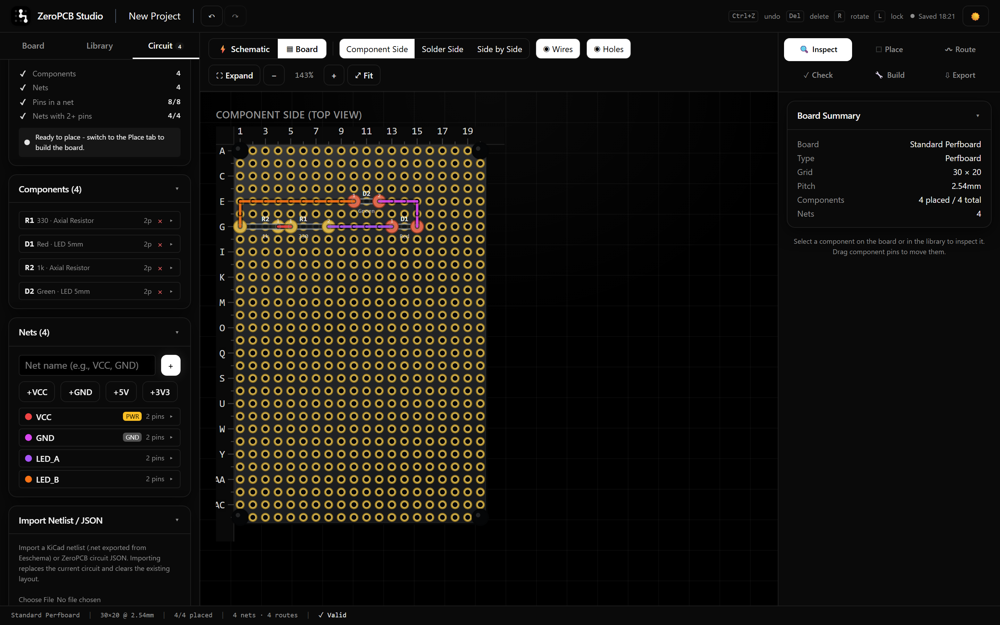
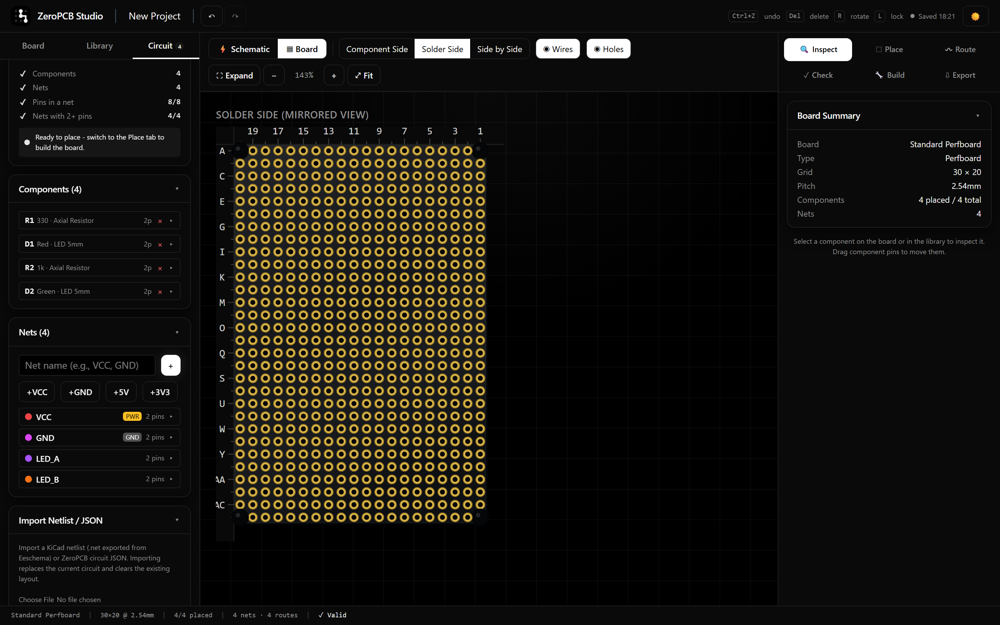
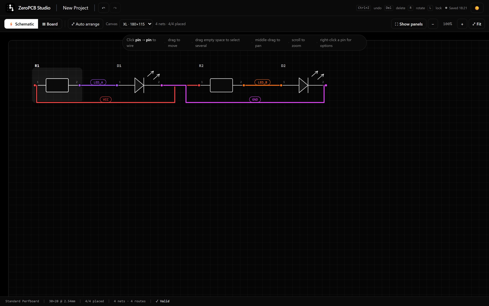
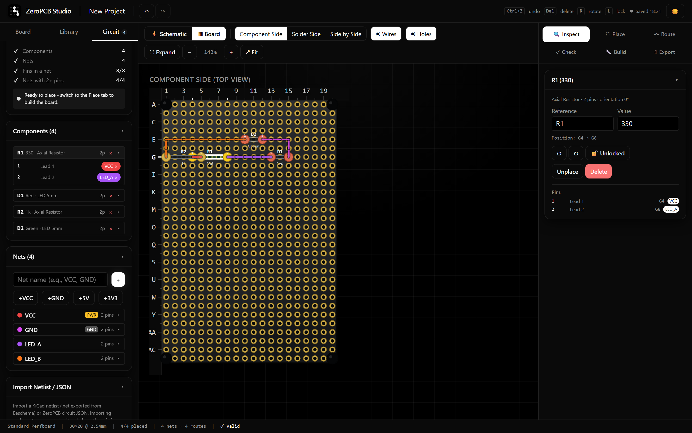
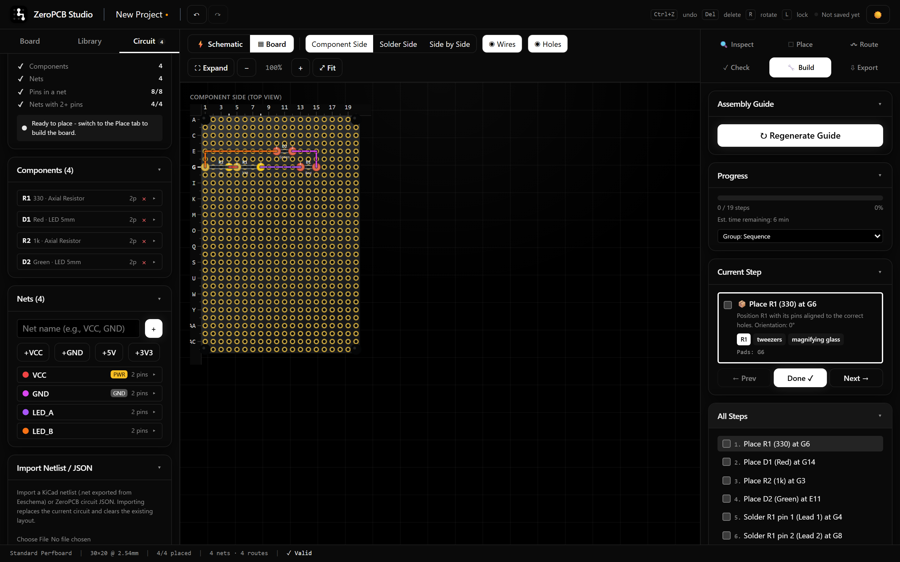
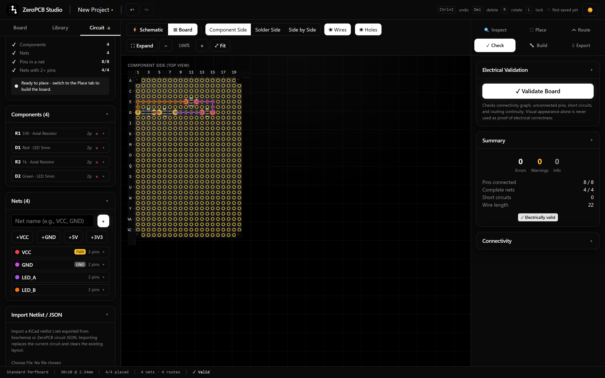

# 🔧 ZeroPCB Studio

[](LICENSE)
[](#development)
[](#quick-start)

**Turn a circuit into a validated, hole-by-hole soldering plan for perfboard / stripboard.**

ZeroPCB Studio is a free, browser-based engineering tool. You describe the circuit (manually, from
a KiCad netlist, or in JSON), pick a board, and the app lays the components out, routes every net
across the hole grid with real A\* search, validates the result electrically, renders a physically
correct solder-side view, and generates a step-by-step assembly guide with exact pad coordinates —
then exports everything as JSON, SVG, PNG, printable PDF, and CSV cut lists.

No paid APIs, no accounts, no server. Everything runs locally in your browser.

Repository: **https://github.com/codertakshiv/ZeroPCB-Studio** · License: **MIT** (free to use,
modify and share — keep the credit, see [License](#license)).

---

## 📸 Screenshots

| | |
| --- | --- |
|  <br> **🖥️ Board view** — placed components, routed nets, spreadsheet-style rulers |  <br> **🔄 Solder side** — true physical mirror with the same coordinates |
|  <br> **⚡ Schematic** — wire pin → pin; filled dot = wired, gold = free |  <br> **📋 Circuit panel** — nets, pins and a readiness checklist |
|  <br> **📖 Assembly guide** — step-by-step soldering instructions |  <br> **✅ Validation** — connectivity and short checks |

---

## ✨ Features

| Area | What it does |
| --- | --- |
| **Board setup** | Perfboard / stripboard / custom dimensions in holes (2.54 mm pitch), mounting holes, strip direction, per-hole track cuts. |
| **Circuit input** | Manual component + pin editor, documented circuit JSON import, and best-effort KiCad netlist (`.net`) import. |
| **Schematic editor** | Interactive EasyEDA-style schematic: drag symbols, marquee-select and move several at once, wheel/pinch zoom, pan, and click pin → pin to wire. Wires show a filled dot where they end on a pin and a bigger dot where several wires join — a plain crossing is never a connection. Nets are routed around symbol bodies and pins so nothing is ambiguous. |
| **Placement** | Drag parts onto the PCB, edit grid coordinates, rotate, and lock components in place. Auto-arrange is optional and supports three modes (min wire length, max neatness, balanced) with Fast / Standard / Thorough intensity. |
| **Routing** | A\* over the hole graph, obstacle- and net-aware. Isolated-pad (perfboard) and stripboard semantics (strips as edges; cuts and mounting holes sever runs). Crossing wires are never treated as junctions. |
| **Validation** | Connectivity graph, unconnected pins, short circuits (including stripboard runs carrying multiple nets), routing continuity. Visual appearance is never used as proof. |
| **Views** | Component side, solder side (true left-right mirror), and side-by-side. Wheel zoom anchored at the cursor, drag to pan, fullscreen schematic editing, and a compact in-canvas help button. Rulers with spreadsheet-style labels (`A1`…`Z30`, multi-letter rows); the pad grid can be hidden for a cleaner look at tracks and components (view only — exports always keep the holes). |
| **Assembly guide** | Dynamically generated steps from the actual layout — place/solder steps per component with real pad coordinates, jumper cutting list, track-cut steps, verification steps, progress tracking. |
| **Exports** | Project JSON (round-trip safe), SVG top/solder, PNG top/solder, printable PDF guide + checklist (via browser print), BOM / netlist / pad list / jumper list / track-cut list CSVs. |
| **Storage** | Autosaves the whole project to this browser's IndexedDB on every change (short debounce) and restores it after a refresh or a new visit — no account, no cloud, no backend. A live indicator shows *Saving… / Saved HH:MM / Save failed*. Named local projects plus Project JSON export/import are available. |
| **Safety** | Components can never silently overlap: placement reports exactly what was placed and why anything failed. Failed placements show errors instead of pretending success. |

## 🚀 Quick start

```bash
git clone https://github.com/codertakshiv/ZeroPCB-Studio.git
cd ZeroPCB-Studio
npm install       # install dependencies
npm run dev       # start the dev server (http://localhost:5173)
npm test          # run the unit/integration suite (vitest)
npm run test:e2e  # run the browser end-to-end suite (playwright)
npm run build     # type-check + production build into dist/
npm run preview   # serve the production build
```

Requirements: **Node.js 20.19+** (or 22.12+), npm.

First-time Playwright use: `npx playwright install chromium`.

## 🔄 Workflow

1. **Board** tab (left) — pick a preset or enter dimensions, set mounting holes.
2. **Library** tab — add components; each gets a reference (`R1`, `D1`, …).
3. **Circuit** tab — create nets (or import a netlist/JSON) and wire the pins, either with the
   net editor or by clicking pin → pin in the **Schematic** view (the ⚡ button in the toolbar).
   Dragging several symbols with a marquee moves them together.
4. **Place** tab (right) — choose a placement mode and intensity, run auto-placement, drag/adjust
   as needed (drag a component pin on the board, `R` rotates, `L` locks).
5. **Route** tab — run A\* routing for all nets. On stripboard, cut tracks by right-clicking a hole
   (component or solder side) and use jumpers where bridges are needed.
6. **Check** tab — run electrical validation; fix anything it reports.
7. **Build** tab — generate the assembly guide, step through it on the canvas.
8. **Export** tab — download diagrams, CSVs, printable guides, and the project file.

Your work is saved as you go: the toolbar shows *Saving… / Saved HH:MM / Save failed*, and closing
or refreshing the page brings the same project back. Nothing leaves the machine except files you
download yourself.

## 📐 Supported board types

| Type | Presets | Semantics |
| --- | --- | --- |
| **Perfboard** | 5×7 cm (18×14), 7×9 cm (35×27), 10×15 cm (58×38) | Each hole is an isolated pad; every connection is a physical wire/jumper. |
| **Stripboard** | 4×6 cm (15×24), 10×30 holes, plus any custom size | Copper strips run horizontally (default) or vertically; all holes on an uncut strip are electrically connected. Mounting holes and track cuts sever strips. |
| **Custom** | any rows × cols at 2.54 mm pitch | Same semantics as perfboard. |

Hole pitch is 2.54 mm (0.1"). Board size presets and margins can be adjusted per project.

## 🔌 Circuit input methods

### 1. Manual editor

Add parts from the built-in library (axial resistors, capacitors, LEDs, diodes, DIP ICs and sockets,
TO-92/TO-220 transistors and regulators, headers, screw terminals, switches, buttons, pots,
crystals, connectors — all through-hole) and wire pins to nets in the Pin Editor.

### 2. Circuit JSON (documented format)

The format below is exactly what **Export JSON** embeds and what the **Import Netlist / JSON**
panel accepts. Components must reference built-in footprint ids; anything unknown is reported and
skipped instead of being guessed.

```json
{
  "version": "1.0",
  "circuit": {
    "name": "LED blinker",
    "components": [
      {
        "id": "c1",
        "footprintId": "resistor-axial",
        "reference": "R1",
        "value": "330",
        "pins": [{ "pinId": "p1", "netName": "VCC" }]
      },
      {
        "id": "c2",
        "footprintId": "led-5mm",
        "reference": "D1",
        "value": "Red",
        "pins": [{ "pinId": "p1", "netName": "LED_A" }, { "pinId": "p2", "netName": "VCC" }]
      }
    ],
    "nets": [{ "name": "VCC", "isPower": true }, { "name": "LED_A" }]
  }
}
```

### 3. KiCad netlist (`.net`)

Export a netlist from Eeschema (File → Export → Netlist) and drop it into the import panel.
The importer maps common through-hole footprints (`R_Axial`, `LED_D5.0mm`, `DIP-nn`, `D_DO-35/41`,
`TO-92`, `TO-220`, `HC49`, `PinHeader_1xNN`, `TerminalBlock_*`, `Conn_01xNN`, …) to built-in
footprints, imports nets and pin connections, and infers power/ground flags from net names.

**Best-effort by design:** SMD packages and anything without a confident match are reported as
errors and skipped — never silently substituted. Pins that don't exist on the mapped footprint are
reported too.

## 🧭 Coordinate system & soldering correctness

- Holes are addressed spreadsheet-style: rows `A`…`Z`, `AA`…; columns `1…N` (1-based).
- Components are always stored in **component-side (top view)** coordinates.
- The **solder-side view** is a true physical mirror (flipped around the vertical axis), so it
  matches what you see when the board is in your hand with the copper facing you.
- Rotation is clockwise in screen space, anchored at the footprint origin, restricted to
  0/90/180/270° — the only angles that keep pins on the 2.54 mm grid.
- Crossings are **not** junctions: two wires crossing on the board never connect unless the
  connectivity graph says so (a shared pad/strip or an explicit connection).

## 📦 Exports

| Export | Notes |
| --- | --- |
| **Project JSON** | Fully round-trippable: board (incl. track cuts), circuit, placement, routes, validation, assembly guide, checklist progress. |
| **SVG (top / solder)** | Print-ready vector diagrams incl. rulers. |
| **PNG (top / solder)** | Rasterized at 2× for documentation. |
| **PDF guide / checklist** | Uses your browser's print dialog — choose "Save as PDF". Allow pop-ups. A4, board diagrams + BOM + every step. |
| **BOM CSV** | Grouped by value/footprint with quantities. |
| **Netlist CSV** | Net → component pin assignments. |
| **Pad list CSV** | Every occupied hole with its coordinate, net and pin. |
| **Jumpers CSV** | Wire cutting list: from/to coordinates, length in mm (holes × 2.54), plus cut allowance. |
| **Track cuts CSV** | Stripboard only: every cut with its coordinate and affected nets. |

## 🛠️ Development

```bash
npm run test          # vitest: transforms, footprints, placement, routing, validation,
                      # store/undo, exporters, importers, local persistence,
                      # full-pipeline integration (184 tests)
npm run test:watch    # watch mode
npm run test:e2e      # playwright: full browser flows incl. import, routing, exports
                      # and autosave/restore after a refresh (19 specs)
npm run lint          # oxlint
```

Source layout:

```
src/
  board/        # board geometry, pads, strip connectivity, coordinate transforms
  circuit/      # circuit model, JSON format, KiCad/JSON import
  footprints/   # footprint registry + built-in library
  placement/    # placement engine (greedy + local search), seeded RNG
  routing/      # A* routing engine + board graph
  validation/   # connectivity, shorts, stripboard run analysis
  soldering/    # assembly guide generation, progress, checklists
  exporters/    # SVG/PNG/CSV/print/JSON serialization
  storage/      # IndexedDB project storage
  app/          # zustand store, App shell
  components/   # all UI panels and the SVG board canvas
  tests/        # vitest suites
e2e/            # playwright specs
docs/           # README screenshots + the script that captures them
```

The README screenshots in `docs/screenshots/` come from the real UI: start the dev server
(`npm run dev -- --port 5199`) and run `node docs/capture-screenshots.mjs` (set `BASE_URL` to
point at another port). The script builds the demo project, places, routes, validates and walks
through the guide before taking each shot.

The test suite covers: coordinate transforms, pin numbering, rotation/mirroring, collision,
placement legality, connectivity, routing around obstacles and occupied pads, shorts, stripboard
tracks/cuts, undo/redo, save/load round-trips, autosave records (board settings, components,
placement, routes, schematic positions and checklist progress survive a reload), SVG/PDF(print)
export content, and instruction generation — including undersized/impossible boards and sample
circuits with known connectivity.

## ⚠️ Limitations & known gaps (honest list)

- **Placement/routing run on the main thread.** There are async yields so the UI can repaint, but
  large boards can make the tab feel busy while optimizing. Web Workers are not implemented yet.
- **PDF export goes through the browser print dialog** (pick "Save as PDF"). There is no direct
  PDF file writer, and pop-ups must be allowed for the print window to open.
- **Routing is orthogonal (Manhattan) on the hole grid.** No diagonal traces, no multi-layer
  boards, no automatic jumper minimization beyond A\* obstacle avoidance. Wires are physical
  jumpers on the component side.
- **Stripboard cuts are manual.** The tool does not automatically compute an optimal cut set;
  it validates and documents the cuts you make (right-click a hole).
- **Rotations are limited to 0/90/180/270°**, and non-rectangular footprints are approximated by
  their bounding boxes for collision checks.
- **KiCad import is best-effort** (see above); the built-in library is through-hole only.
- **Custom components** are created via the library's custom-part dialog (single-row pin
  layout) and are persisted inside project JSON files, not as a shared library.
- **Undo history is limited to 50 steps** per session, and text edits to references/values are
  not separately undoable (structural changes are).
- **The schematic is a wiring aid, not a simulator.** It draws the nets you create in the Circuit
  tab (pin → pin), with pad-accurate junctions, but there is no ERC, no component model and no
  circuit simulation. Correctness of the *design* is still up to you; the tool validates the
  *board* (connectivity, shorts, routing).
- **Browser storage is per-browser.** The project autosaves into this browser's IndexedDB, so it
  comes back after a refresh, but it does not sync between machines, browsers or tabs — use project
  JSON files for backup and sharing. Clearing site data deletes the saved project.

## ⚙️ Tech stack

React 19 + TypeScript + Vite, Tailwind CSS v4, Zustand, Vitest, Playwright, IndexedDB.
No paid services; runs entirely client-side.

## ⚖️ License

**MIT** © 2026 [Takshiv Kashyap](https://github.com/codertakshiv) — free to use, modify, share and build
on, commercially or not, **as long as the copyright notice and license text stay with it**
(credit: *ZeroPCB Studio by codertakshiv*). See [LICENSE](LICENSE).

Contributions, bug reports and feature ideas are welcome via
[issues](https://github.com/codertakshiv/ZeroPCB-Studio/issues) and pull requests.

## 👏 Credits

Built by [codertakshiv](https://github.com/codertakshiv). Schematic symbols, board geometry,
placement and A\* routing engines, exporters and the UI were written for this project — no EDA
library is bundled. If you use ZeroPCB Studio in a project or tutorial, a link back to the
repository is appreciated.
